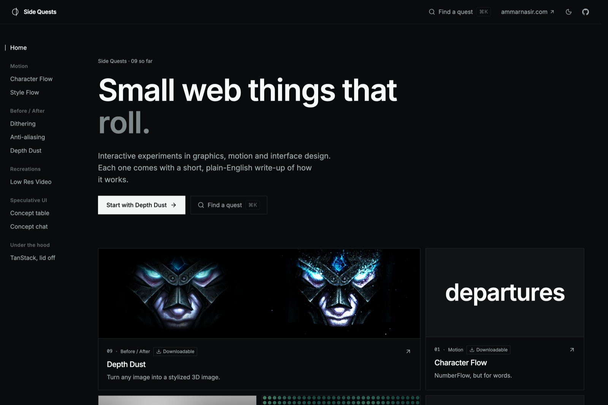

# Side Quests

Small web things that roll, dither, glow and shimmer.

**[fanoflix.github.io/side-quests](https://fanoflix.github.io/side-quests/)**



Interactive experiments in graphics, motion and interface design. Each one is
its own page, and each comes with a short, plain-English write-up of how it
works right under the tool, plus a longer version with the real numbers and
the maths.

## The quests

| Quest | What it is |
| --- | --- |
| **Motion** | |
| [Character Flow](https://fanoflix.github.io/side-quests/character-flow) | NumberFlow, but for words. On npm. |
| [Style Flow](https://fanoflix.github.io/side-quests/style-flow) | Every letter picks its own weight, slant and font, live. On npm. |
| **Before / After** | |
| [Dithering](https://fanoflix.github.io/side-quests/dithering) | Old games only had a handful of colours, so they faked the rest with dots. |
| [Anti-aliasing](https://fanoflix.github.io/side-quests/anti-aliasing) | Pixels are square, so every curve on your screen is really a staircase. |
| [Depth Dust](https://fanoflix.github.io/side-quests/depth-dust) | Turn any image into a stylized 3D image. On npm. |
| **Recreations** | |
| [Low Res Video](https://fanoflix.github.io/side-quests/low-res-video) | How few dots does a video need before you can't tell what it is? |
| **Speculative UI** | |
| [Concept table](https://fanoflix.github.io/side-quests/future-table) | What if table rows never moved, and only what's in them changed? |
| [Concept chat](https://fanoflix.github.io/side-quests/concept-chat) | What if a text message kept the timing of how you typed it? |
| **Under the hood** | |
| [TanStack, lid off](https://fanoflix.github.io/side-quests/tanstack-showcase) | The same app built three ways, so you can watch the bookkeeping disappear. |

## Use them in your own app

Depth Dust, Character Flow and Style Flow are React components in
[`side-quests-lab`](https://www.npmjs.com/package/side-quests-lab), with no
Tailwind or other setup needed.

```bash
npm i side-quests-lab motion
```

```tsx
import { CharacterFlow, DepthDust, StyleFlow } from "side-quests-lab"
```

Every prop, how to get a depth map for Depth Dust, and the fonts Style Flow
needs are in the [package README](packages/side-quests-lab/README.md). Each
tool's page also has a copy-ready snippet that follows its controls.

## How it's built

- **App:** React 19 on TanStack Start and Router, prerendered and served as a
  static site from GitHub Pages. Vite 8, Tailwind v4, shadcn on Base UI, and
  Motion for animation.
- **Depth Dust:** plain WebGL2, half a million points in a few draw calls,
  with depth from [Depth Anything V2](https://huggingface.co/onnx-community/depth-anything-v2-small)
  running in the browser (WebGPU when available) through
  `@huggingface/transformers`. Inspired by
  [Gather](https://gather.be-of-dao.com) by DAO.
- **Layout of a quest:** each lives in `src/features/<category>/<slug>/`, with
  its code next to `explainer.md` (the short write-up shown on the page) and
  `how-it-works.md` (the full version). [AGENTS.md](AGENTS.md) has the
  conventions.

## Running it

Node 22+ and Yarn 4 via corepack.

```bash
corepack enable
yarn install
yarn dev          # http://localhost:3005
```

Other scripts:

| Command | What it does |
| --- | --- |
| `yarn test` | Runs the unit tests. |
| `yarn og` | Regenerates the link-preview images (needs `yarn dev` running). |
| `yarn depth <picture> <out.png>` | Makes a depth map for a picture. |
| `yarn build:lab` | Builds the `side-quests-lab` package. |

## Contributing

Bug fixes and typo fixes are very welcome; new tools start as an issue.
See [CONTRIBUTING.md](CONTRIBUTING.md).

## Licence

[Apache 2.0](LICENSE).
