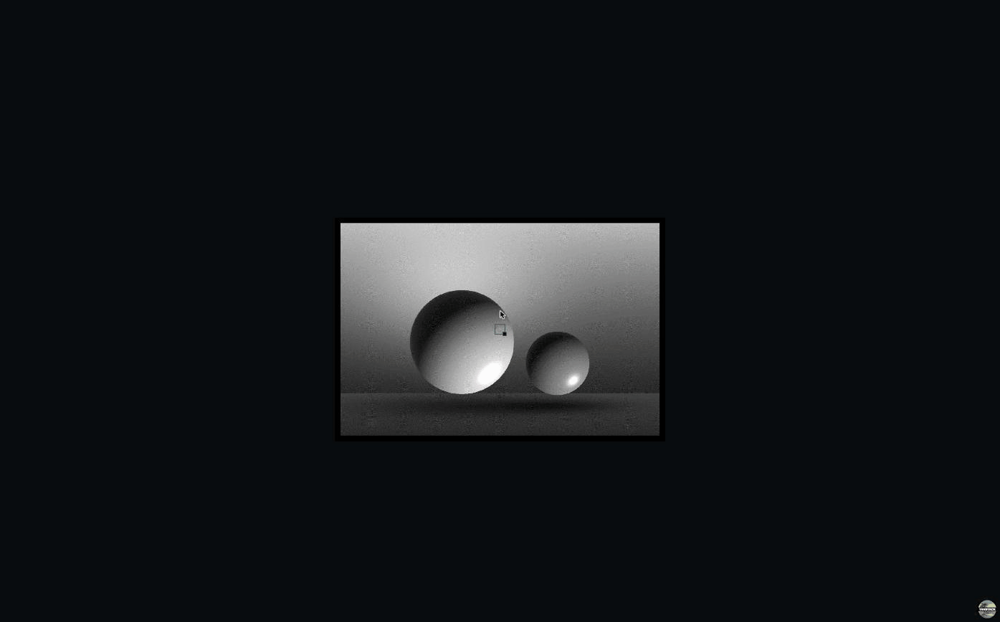
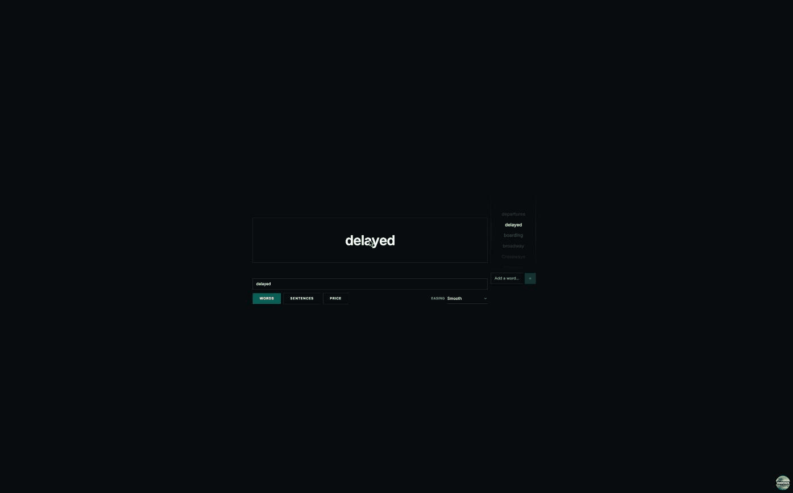

# webfun

Fun little things for the web.

Somethings might become the future, who knows. Never hurts to experiment.

**[fanoflix.github.io/webfun](https://fanoflix.github.io/webfun/)**

Small, self-contained interactive experiments — graphics techniques, motion
studies, speculative UI. Each one lives at its own route and ships an explainer
doc next to its code, because the point is to understand the thing, not just
watch it.

## The reel

A 20-second exciting moment from each tool. Each clip is captured at the point a
reader would see the trick land — not the whole demo, just the beat worth
rewinding.

### Dithering — _dots become a photo_

Zoom out from a field of black-and-white dots and the pattern resolves into a
full greyscale photograph your eye has blended on its own.



### Anti-aliasing — _staircase melts smooth_

Slide the Samples lever from 1 to 8 and watch a jagged diagonal staircase melt
into a clean straight edge the screen never actually drew.

<!--  -->

### Low Res Video — _dot field becomes video_

Pull back on a few hundred coloured dots on black and the field resolves into a
moving picture; then flick the dot shape from circle to diamond.

<!--  -->

### Character Flow — _odometer-rolling letters_

Letters shared between two words slide across in place while the unmatched ones
roll in like an odometer — a digit that changed more travels visibly faster in
the same time.



### Style Flow — _one word, breathing_

A single word sits still, then starts to breathe: one letter thickens, another
leans into italic, another sprouts serifs, before the whole run eases home to a
clean wordmark.

<!--  -->

### Concept table 1 — _split-flap row flip_

The data changes but no row moves; each slot flips over in place like a
split-flap departure board, so your eyes never have to re-find where they were.

<!--  -->

### Concept chat — _message performs itself_

A chat message arrives as a poster with a play button; press play and the lines
perform themselves one after another at the pace the sender chose.

<!--  -->

### TanStack, lid off — _flip the status, watch nothing happen_

Change a ticket's status at the TanStack DB rung and the inbox updates in the
same tick while the right-hand timeline shows the write landing locally before
any request has gone out.

<!--  -->

## Running it

Node 22+ and Yarn 4 via corepack.

```bash
corepack enable
yarn install
yarn dev          # http://localhost:3005
```

## Contributing

Bug fixes and typo fixes are very welcome; new tools start as an issue.
See [CONTRIBUTING.md](CONTRIBUTING.md).

## Licence

[Apache 2.0](LICENSE).
